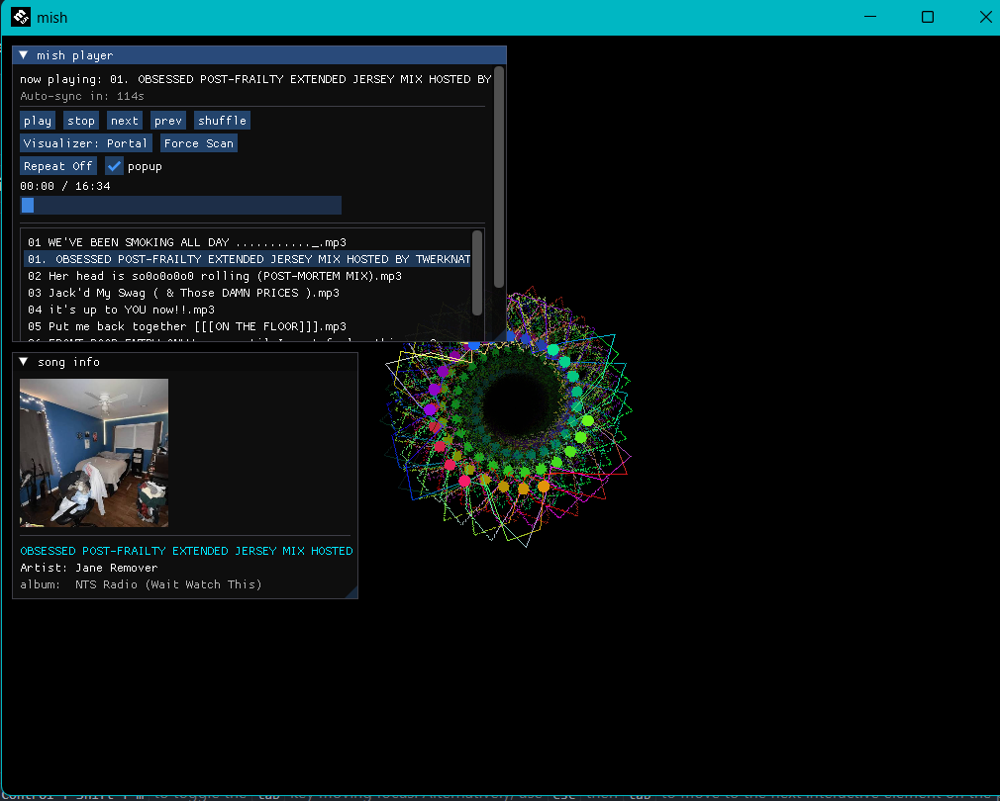
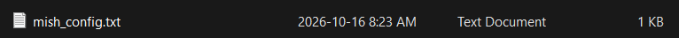
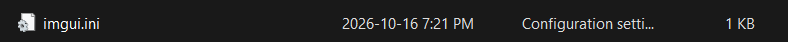
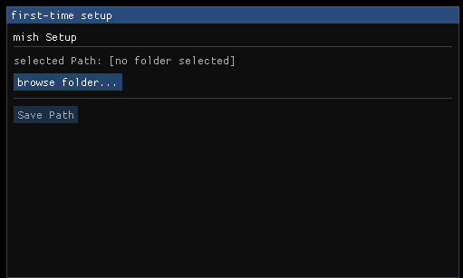

<div align="center">

```
           _     _     
 _ __ ___ (_)___| |__  
| '_ ` _ \| / __| '_ \
| | | | | | \__ \ | | |
|_| |_| |_|_|___/_| |_|
```

# mish 🎵


**mish (C) 2026 by josh**


</div>

---

> a minimalist music player, designed as a love letter to the 2000s.

mish is a very light music player focused on simplicity, nostalgia, and aesthetic.

⚠️ mish is currently in early ALPHA. If you find any bugs, don't hesitate to report!
---

## ✨ Features

- 🎨 sick ass visuals
- 🖼️ automatic album art detection
- 📂 playlist support(soon*)
- 🔍 automatic music folder scanning(You can use "Force Scan" to update your tracks; auto-scan is every 2 minutes)
- 🎧 MP3 / WAV / OGG support(id3 tags)
- 🧊 FLAC support (CONFIRMED!)
- 💾 remembers your settings
- 🖥️ lightweight desktop app (only 13MB!)

---

## 📸 Screenshots

<p align="center">

</p>

---

## 🚀 Getting Started

### First launch/Setup

mish has a first-time setup wizard.

when opening mish for the first time:

<p align="center">


</p>
These are created on initial setup. i cannot stress that you **DON'T** delete them.
Start by picking out your music folder, as listed here:
<p align="center">

</p>

## 📁 Important Files

please do not delete:

```
imgui.ini
mish_config.txt
```

these files store things like:

- playlist data
- settings
- automatic scanning information

---

## 🛠️ Roadmap

things planned for future versions:

- [ ] better playlist management
- [✓] more visual effects(visualizer/calm mode)
- [✓] improved album art handling
- [ ] equalizer
- [ ] customizable themes
- [ ] more audio formats
- [✓] Linux support

---

## 🐛 Known Issues

because mish is still alpha, there may be issues. Fortunately, they are currently unknown, but don't hesitate to report!

---

## 💙 Credits

made by **josh**

mish is a personal project built out of love for winamp.

thanks for trying it :)

---

## 📜 License
mish is licensed under the GNU General License v3.
see [LICENSE.TXT](license.txt) for details :P
